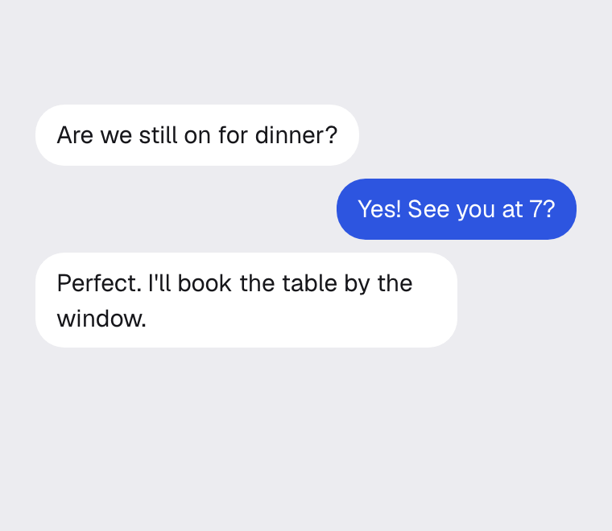

# repousse

[](https://github.com/jordankmars/emerse/actions/workflows/ci.yml)
[](./LICENSE)

> Press and hold an item to lift it above a blurred page, with a menu next to it.

<p align="center">
	
</p>

Keep your finger down and slide onto an option to pick it in one motion, or let
go and tap through the menu afterward. Right-click and the keyboard open it too.

The hard part isn't the animation. It's telling a long press apart from a scroll,
a tap or text selection, keeping the iOS callout and Android context menu out of
the way, and making sure the menu still works for people who can't hold a press.

## Install

```sh
npm install repousse
```

The React adapter needs React 18 or later.

## Usage

```tsx
import { Repousse } from "repousse/react";

<Repousse.Root>
	<Repousse.Trigger>…message…</Repousse.Trigger>
	<Repousse.Overlay className="scrim" />
	<Repousse.Menu className="menu">
		<Repousse.Item onSelect={reply}>Reply</Repousse.Item>
		<Repousse.Item onSelect={copy}>Copy</Repousse.Item>
	</Repousse.Menu>
</Repousse.Root>;
```

| Part               | Renders           | Props                                                                                                                                                     |
| ------------------ | ----------------- | --------------------------------------------------------------------------------------------------------------------------------------------------------- |
| `Repousse.Root`    | nothing           | `onOpenChange(open)`, called when the menu starts opening and closing. `onClosed`, called once it has finished closing. `container`, defaults to the body |
| `Repousse.Trigger` | `div`             | `asChild`, and `clone` to build the lifted copy yourself                                                                                                  |
| `Repousse.Overlay` | `div`, while open | Optional. Without it, outside taps still dismiss the menu but nothing is painted                                                                          |
| `Repousse.Menu`    | `div`, while open | `align`, `"start"` or `"end"`                                                                                                                             |
| `Repousse.Item`    | `button`          | `onSelect`, `disabled`, `asChild`                                                                                                                         |

Every part that renders an element also takes that element's usual props and a
ref. `asChild` puts the behaviour on your own element instead:

```tsx
<Repousse.Item asChild onSelect={open}>
	<a href="/thread">Open thread</a>
</Repousse.Item>;
```

### Removing an item

Unmounting the Root ends the close animation on the spot. To let it finish, note
the pick in `onSelect` and remove the item in `onClosed`:

```tsx
function Message({ remove }: { remove: () => void }) {
	const deleting = useRef(false);
	return (
		<Repousse.Root onClosed={() => deleting.current && remove()}>
			<Repousse.Trigger>…message…</Repousse.Trigger>
			<Repousse.Menu>
				<Repousse.Item onSelect={() => (deleting.current = true)}>
					Delete
				</Repousse.Item>
			</Repousse.Menu>
		</Repousse.Root>
	);
}
```

## Styling

repousse ships no styles, so the blur, the shadow and the menu's look are yours.
These are the hooks:

| Selector                  | What it is                                      |
| ------------------------- | ----------------------------------------------- |
| `[data-repousse-overlay]` | The overlay, including the one you don't render |
| `[data-repousse-lifted]`  | The lifted copy of the trigger                  |
| `[data-highlighted]`      | The item under a drag                           |

A starting point. The z-indices only matter if the page has z-indexed content of
its own, and all three need setting together, or the overlay covers the rest.

```css
[data-repousse-overlay] {
	z-index: 60;
	background: rgb(0 0 0 / 0.25);
	-webkit-backdrop-filter: blur(10px);
	backdrop-filter: blur(10px);
}

[data-repousse-lifted] {
	z-index: 61;
	box-shadow: 0 12px 32px rgb(0 0 0 / 0.18);
}

.menu {
	z-index: 62;
	background: white;
	border-radius: 14px;
}

.menu [data-highlighted],
.menu [role="menuitem"]:hover {
	background: #eee;
}
```

## Adapters

| Framework | Import path       | Status      |
| --------- | ----------------- | ----------- |
| React     | `repousse/react`  | Available   |
| Vue       | `repousse/vue`    | Coming soon |
| Svelte    | `repousse/svelte` | Coming soon |

## Development

```sh
pnpm install
pnpm test               # unit tests
pnpm playground         # playground at localhost:5173
pnpm playground --host  # same, reachable from a phone on your network
pnpm site:dev           # docs site, builds the library first
pnpm site:build         # static docs site in site/out
```

The playground uses the React adapter, all in one file. Long presses behave
differently on real devices, so it's worth opening it on a phone.

## Contributing

Bug reports and pull requests are welcome. For anything bigger than a fix, open
an issue first so we can agree on the approach.

Before sending a pull request, run `pnpm lint`, `pnpm typecheck` and `pnpm test`.
If the change touches pressing, dragging or scrolling, try it on a real phone
too, through `pnpm playground --host`.

## License

[MIT](./LICENSE)
